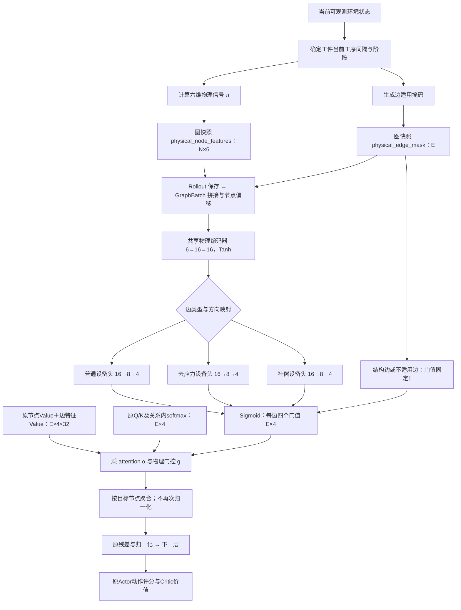

# 六维物理信号与多头边门控

本次新增可选物理门控，保留原有关系专属K/V、attention、Actor/Critic、奖励和合法动作逻辑。默认`physical_gating=false`，未启动门控训练，也未改动既有实验配置。共享K/V和类型FiLM不属于本次实现。

## 数据处理框图



图中32维为hidden128、4heads时的head宽度。模型的门控输出数跟随`attention_heads`，默认4；网络宽度16和8固定。

## 六维信号定义

从**当前已完成工序**的释放间隔提取物理参数。设当前变形为D，该工序饱和值为A，补偿阈值为θ，剩余自然等待为R，可见工件导出的原时间尺度为S=max(1,duration_scale)。

| 位置 | 字段 | 定义 |
| --- | --- | --- |
| 0 | deformation_to_saturation_ratio | D/A |
| 1 | normalized_remaining_natural_dwell | R/S |
| 2 | current_compensation_margin | (θ−D)/θ，负值表示超阈值 |
| 3 | normalized_relief_release_time_gain | [R−min_m(已知M3类设备等待_m＋处理时长_m)]/S，保留负值 |
| 4 | post_relief_compensation_margin | [θ−apply_stress_relief(D,A)]/θ；当前默认物理模型处理后为A |
| 5 | relief_used_in_current_interval | 自最近一次普通工序完成以来是否完成过主动去应力；补偿后仍为1，下一普通工序完成后重新判定 |

“M3”按`stress_relief.machines`的角色识别，不写死机器名字，因此测试中的R、未来其它名字均适用。若存在多个去应力设备，第3维取当前已知最早完成释放的设备，不是每条机器边各自独立的预估；各同类边门值相同符合本轮工序物理门控设计。未来可扩展机器条件，但本轮未增加维数。

第3维是**释放完成时间收益**，不含后续补偿、未来排程和新事件造成的时间变化。两条补偿裕量由同一个补偿阈值计算，不截掉负号。去应力当前实现将变形稳定到A，不能解释为减小变形。未定义／禁用去应力时第3、4维为0；若补偿阈值缺失、非正或补偿被禁用，整个物理门控标记不适用，返回中性门值1。

## 工序与边的映射

当前有完整释放间隔、工件不忙碌且未全部完成时才启用：

- 普通设备关系4/5：关联当前下一道待加工工序，读取它前面的当前释放间隔。
- 去应力关系6/7、补偿关系8/9：关联上一道刚完成工序，读取该工序后的当前释放间隔。
- 结构关系0–3固定为1；首工序尚无前置释放间隔、忙碌／中断工件、其它远期和过去间隔固定为1。

辅助关系在自然释放完成或已经用过M3后仍可携带当前间隔信息，信号可表示当前状态；这不表示对应动作合法。合法性继续由环境决定，门控不筛除候选动作。

正反关系根据工序端点取信号，机器→工序不会读机器节点的“物理槽位”。同一间隔的信号复制到上一已完成工序及下一待加工工序两处，配合边适用掩码避免向其它阶段误传。图只包含已可见工件，不读取隐藏任务和未来事件；物理特征、适用掩码每步独立生成，不被后续环境步修改。

## 网络与消息计算

共享编码器`Linear(6,16)→Tanh→Linear(16,16)→Tanh`；三个关系组的门控头均为`Linear(16,8)→Tanh→Linear(8,heads)→Sigmoid`。编码器和三个头在两层message passing之间共享，同组正反方向共享；两层使用同一物理门值，不增加逐层门控参数。默认4head时新增900参数。

$$
g_{e,h}=\sigma(\mathrm{Head}_{c(e)}(\mathrm{Encoder}(\pi_o)))_h,
\qquad
m_{e,h}=\alpha_{e,h}g_{e,h}(W^V_rh_j+U_rx_e)_h.
$$

门控对完整Value作用，无绕过门控的边值项；attention归一化方式保持原有“关系类型＋目标节点”内softmax。门控不进入softmax分母，乘完不重新归一化，单入边也可衰减。

`physical_gate_initial=0.9`控制末层bias的logit；末层weight用标准差0.001的小非零值初始化，因此初始门值**接近**0.9，并允许第一步梯度进入物理编码器。新增门控会改变初始模型输出，不保证与已有模型严格一致。未加入Dropout。

## 代码位置与使用

- 信号和阶段映射：`src/ppo_rs/environment/fjsp_env.py`的`_physical_gate_graph_fields`。
- 取图：`env.get_graph_state(actions, include_physics=True)`；默认不生成新增字段，旧图与旧模型路径保持。
- 图拼接：`src/ppo_rs/models/graph_batch.py`；字段沿RolloutBuffer、全局轨迹收集和PPO batch保留。
- 门控网络：`src/ppo_rs/models/physical_gate.py`。
- 门控应用：`graph_actor_critic.py`与`graph_attention.py`；使用`model.get_edge_gates(graph_batch)`可导出[E,heads]门值，函数可微；只诊断时包裹`torch.no_grad()`。
- 训练采样及验证按模型开关自动请求带物理字段的图，无需修改原始dataset文件。
- 模型工厂、训练配置读取和checkpoint model_kwargs保存开关、初始门值与门控schema版本；关门控时旧checkpoint kwargs和state_dict结构保持。

配置示例：`configs/physical_gate/full_gnn_static.json`和`full_gnn_dynamic.json`，默认dataset1_cost0、完整state、单GPU、20k／10k回合，独立输出目录。门控也支持compact18／compact21；更换state组必须匹配静态来源。两项新增配置如下：

```json
{
  "physical_gating": true,
  "physical_gate_initial": 0.9
}
```

未启用门控的配置无需添加字段，继续原模型；MLP配置启用该项会明确报错。

以下是**未来手动使用示例**，不是本次已启动任务；当前GPU已有实验在运行。静态从头训练：

```bash
cd /root/VLA/FJSP-PPO-cloud
CUDA_VISIBLE_DEVICES=0 PYTHONPATH=src \
  /root/miniconda3/envs/datascience/bin/python -m ppo_rs.train \
  --config configs/physical_gate/full_gnn_static.json
```

动态示例配置故意不绑定任何现有旧模型；必须用本次新门控静态运行的实际路径覆盖`--initialize-from`：

```bash
CUDA_VISIBLE_DEVICES=0 PYTHONPATH=src \
  /root/miniconda3/envs/datascience/bin/python -m ppo_rs.train \
  --config configs/physical_gate/full_gnn_dynamic.json \
  --initialize-from /实际新门控静态运行目录/checkpoints/best.pt
```

示例输出采用unique子目录，不覆盖原有fullstate或simplestate结果。该配置不是当前三数据集自动链的成员。多GPU时应同时修改`distributed_world_size`并通过torchrun启动；本轮不自动改变预算或分卡。

门控模型应从头静态训练，或使用明确的迁移工具初始化；本次没有放宽strict load，旧无门控checkpoint不能直接初始化为门控模型。新门控模型的静态best可以直接用于对应动态训练，Adam与计数保持原有重置行为。

## 验证与限制

dataset1使用GPU0–1的静态→动态手动串联脚本为`scripts/train_gnn_gate_set1.sh`。当前simplestate dataset1四阶段全部完成后，执行：

```bash
cd /root/VLA/FJSP-PPO-cloud
nohup bash scripts/train_gnn_gate_set1.sh > outputs/gnn_gate_set1_launcher.log 2>&1 < /dev/null &
```

此命令不自动等待：已有simplestate dataset1链未complete会退出。输出精确为`outputs/GNN+gate_set1/static`与`dynamic`，每阶段保存training_config.json、training.log、preflight.json、曲线原始数据及checkpoints/best.pt、latest.pt、final.pt。脚本使用完整state、dataset1_cost0、两卡、20k／10k预算，动态来源自动绑定本次static/checkpoints/best.pt；静态执行失败或历史／checkpoint不完整则不启动动态，已有父目录则拒绝覆盖。新脚本通过bash -n语法检查，尚未执行正式训练。

已检查六维数值与负收益、去应力／补偿状态、阶段映射、正反门值一致、结构／不适用边为1、快照独立、批图对齐、无边图、隐藏信息不泄漏、单入边及边Value路径、梯度更新、PPO未更新概率一致、旧schema回载、新checkpoint回载和静态到动态微调。新增门控900参数，未实现FiLM。

门控分支和原网络都可能使用相似物理信息，实际质量收益仍需独立训练与消融。应以相同测试集比较原GNN、门控GNN，保持输入与预算口径，记录图构造和推理额外时间；门值不是动作概率或物理安全证明。
