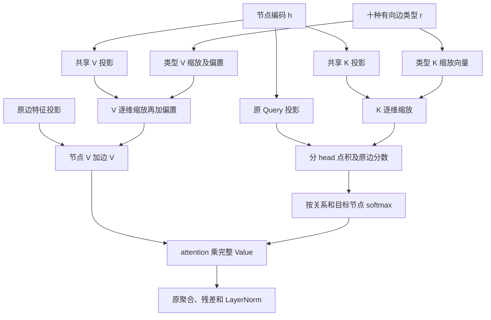

# 共享 K/V＋类型 FiLM

这是独立于物理门控的 GNN 变体。配置 `shared_kv_film: true`、`physical_gating: false` 开启；原配置默认使用原版关系独立 K/V。新结构已接入训练、采样、验证、保存、回载和静态权重迁移，不自动启动正式训练。

## 每层计算

节点编码 $h_j\in\mathbb R^{128}$，关系 $r\in\{0,\ldots,9\}$。K、V 各用一个不同的共享投影矩阵，十种关系共用；两层的投影矩阵及 FiLM 表各自独立。

$$
k_j=W_Kh_j,\qquad v_j=W_Vh_j
$$

$$
\widetilde k_{j,r}=\gamma^K_r\odot k_j,
\qquad
\widetilde v_{j,r}=\gamma^V_r\odot v_j+\beta^V_r+U_rx_{ij}
$$

$$
\alpha_{ij,r}=\operatorname{softmax}_{j\in\mathcal N_r(i)}
\left(\frac{q_i^\top\widetilde k_{j,r}}{\sqrt{32}}+b_r(x_{ij})\right),
\qquad
m_{ij,r}=\alpha_{ij,r}\widetilde v_{j,r}
$$

上式点积及消息按四个 head 分别计算。FiLM 只调制节点 Value，原关系边 Value $U_rx_{ij}$ 随后相加。保留原 Query、边分数、关系内目标节点 softmax、残差、LayerNorm 和 Actor/Critic；没有物理信号或物理门控。

每层三张可训练表 `film_key_scale`、`film_value_scale`、`film_value_bias` 均为 `[10,128]`；每条边取对应关系一行后逐维运算。缩放初始化为 1，V 偏置初始化为 0，缩放不受 Sigmoid 限制。静态类型 K 偏置在当前分组 softmax 中抵消，因此不设置。参数全部由 PPO 反向传播更新，不添加辅助监督目标。



## 代码位置与参数量

- `src/ppo_rs/models/graph_attention.py`：共享投影、三张类型参数表与逐关系消息计算。共享 K/V 每节点计算一次，再索引到边。
- `src/ppo_rs/models/graph_actor_critic.py`：开关、互斥校验及 checkpoint 架构信息。
- `src/ppo_rs/models/factory.py`、`src/ppo_rs/train.py`：构建、保存回载与训练入口。
- `scripts/check_comparison.py`：模型审查支持；`tests/test_shared_kv_film.py`：公式、梯度、概率及兼容性测试。

完整 state、hidden128、两层四头时，原模型 1,002,274 参数，新模型 **420,130** 参数，减少 582,144，约 58.1%。这不直接代表训练墙钟时间缩短相同比例。门控参数不计入本变体。

## 静态／动态训练示例

独立配置在 `configs/shared_kv_film/full_gnn_static.json` 和 `full_gnn_dynamic.json`，默认 dataset1_cost0、完整 state、seed7、单 GPU；静态 20,000 回合、动态 10,000 回合，batch64，保持原学习率及熵系数计划。输出根目录分别为 `outputs/shared_kv_film/dataset1/static/GNN`、`dynamic/GNN`，每次使用独立子目录。

手动训练前先选择空闲 GPU；以下 `<空闲GPU编号>` 和 `<本次FiLM静态运行目录>` 需替换为实际值：

```bash
cd /root/VLA/FJSP-PPO-cloud
CUDA_VISIBLE_DEVICES=<空闲GPU编号> PYTHONPATH=src \
  /root/miniconda3/envs/datascience/bin/python -u -m ppo_rs.train \
  --config configs/shared_kv_film/full_gnn_static.json
```

静态完成后，使用终端打印的 `run_directory` 找到新结构的最佳 checkpoint，再运行：

```bash
CUDA_VISIBLE_DEVICES=<空闲GPU编号> PYTHONPATH=src \
  /root/miniconda3/envs/datascience/bin/python -u -m ppo_rs.train \
  --config configs/shared_kv_film/full_gnn_dynamic.json \
  --initialize-from <本次FiLM静态运行目录>/checkpoints/best.pt
```

动态配置不预填不存在的 checkpoint 路径；需要显式传入 `--initialize-from` 才是静态后微调，不传则按训练入口原语义从头训练。动态仅迁移匹配架构的权重，重新初始化优化器与训练历史。这两个命令不构成自动串行脚本。

## 兼容与实验边界

`shared_kv_film` 默认 false，不增加旧模型参数、不改变旧初始化随机数顺序；旧 checkpoint kwargs 原样保留。开启时 checkpoint 自动加入 `shared_kv_film: true` 和 `shared_kv_film_schema_version: 1`，评估时据此还原结构。

新结构不能无损表示原版十套任意独立 K/V，不支持把旧独立 K/V checkpoint 严格加载为 FiLM 模型。应从新静态训练开始，再迁移至新动态训练。FiLM 初始恒等只对应共享 K/V 基线，不等同于原版独立 K/V 模型。

当前模型入口拒绝同时开启 `shared_kv_film` 和 `physical_gating`。已有 fullstate、simplestate 配置及监督脚本未改动；本次未启动新正式训练。
